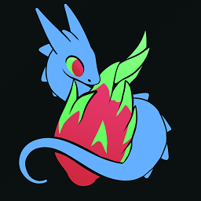
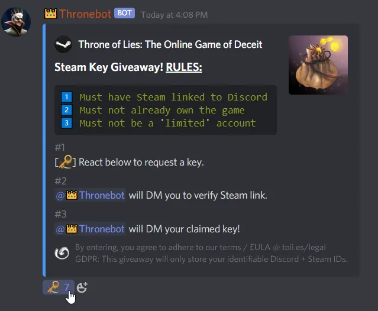
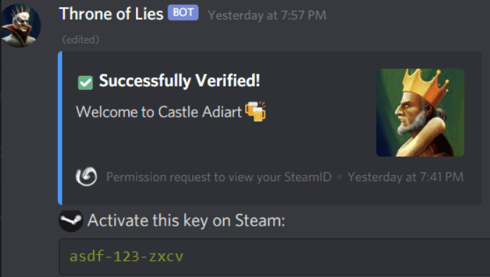
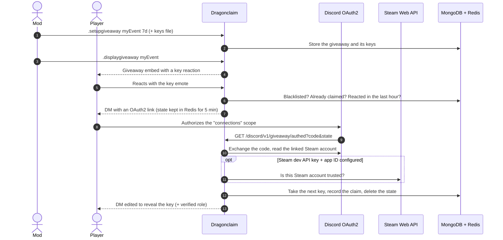

<div align="center">

<h1>
  &nbsp;Dragonclaim
</h1>

### React. Verify. Key in your DMs.

A self-hosted Discord bot that runs Steam key giveaways.<br>
Players react to an embed, verify their linked Steam account through Discord OAuth2, and get a key by DM.

[](LICENSE)
[](https://github.com/Imperium42/dragonclaim/stargazers)
[](https://github.com/Imperium42/dragonclaim/commits)
[](https://github.com/Imperium42/dragonclaim)

[](https://nodejs.org)
[](https://bun.com)
[](https://www.typescriptlang.org)
[](https://discord.js.org)
[](https://expressjs.com)
[](https://www.mongodb.com)
[](https://redis.io)
[](prod.Dockerfile)

[**Video demo**](https://www.youtube.com/watch?v=IKQdpECa42Y) &nbsp;&middot;&nbsp;
[**Learn more**](https://www.imperium42.com/project/dragonclaim-discord-bot) &nbsp;&middot;&nbsp;
[**Blog post**](https://imperium42.com/posts/the-1st-smart-steam-key-giveaway-bot) &nbsp;&middot;&nbsp;
[**Quick start**](#quick-start) &nbsp;&middot;&nbsp;
[**Production guide**](README-PROD.md) &nbsp;&middot;&nbsp;
[**Changelog**](CHANGELOG.md)

<a href="https://www.youtube.com/watch?v=IKQdpECa42Y"></a>

<sub>Click the thumbnail to watch the demo on YouTube.</sub>

</div>

---

## Screenshots

<table>
  <tr>
    <td align="center" width="50%">
      
    </td>
    <td align="center" width="50%">
      
    </td>
  </tr>
  <tr>
    <td align="center"><sub><b>1. The giveaway embed.</b> Players read the rules and react to request a key.</sub></td>
    <td align="center"><sub><b>2. The verified DM.</b> After the Steam link is verified, the bot DMs the key.</sub></td>
  </tr>
</table>

## Contents

- [Screenshots](#screenshots)
- [Why Dragonclaim](#why-dragonclaim)
- [How it works](#how-it-works)
- [Quick start](#quick-start)
- [Configuration](#configuration)
- [Commands](#commands)
- [Scripts](#scripts)
- [Tech stack](#tech-stack)
- [Production deployment](#production-deployment)
- [Security](#security)
- [Web Portal (separate repo)](#web-portal-separate-repo)
- [Troubleshooting](#troubleshooting)
- [Roadmap](#roadmap)
- [License](#license)

## Why Dragonclaim

|                           |                                                                                                                                                                                                                                                                                                               |
| ------------------------- | ------------------------------------------------------------------------------------------------------------------------------------------------------------------------------------------------------------------------------------------------------------------------------------------------------------- |
| **No typing to claim**    | A player reacts with the key emote, opens the link the bot DMs them, and authorizes on Discord. That's the whole flow.                                                                                                                                                                                        |
| **Keys stay private**     | The key is delivered by DM (the bot edits its own DM to reveal it), never posted in a public channel.                                                                                                                                                                                                         |
| **One key per account**   | Claims are recorded per Discord ID and re-checked right before a key is handed out. Each reaction is locked out for an hour, and OAuth links expire after 5 minutes and work once.                                                                                                                            |
| **Bot farms don't scale** | A claim needs a Discord account with a Steam account linked in its Discord connections, then a browser OAuth2 login to prove it. The bot reads that link through the `connections` scope, so a scripted account with no linked Steam gets nothing. Faking a few is possible; faking an army is a lot of work. |
| **Steam-verified**        | The claimer must have a Steam account linked to Discord. With a Steam publisher (dev) API key and app ID, the bot also asks Steam whether the account is trusted, and blacklists accounts that are not.                                                                                                       |
| **Runs itself**           | A giveaway ends on its own when the timer runs out or the last key is claimed, and the public embed is edited to show that it concluded.                                                                                                                                                                      |
| **Yours to host**         | One YAML file configures everything, including every user-facing string, emote and embed color. [MPL-2.0](LICENSE) licensed.                                                                                                                                                                                  |

The story behind it is in the blog post
[The 1st smart Steam key giveaway bot](https://imperium42.com/posts/the-1st-smart-steam-key-giveaway-bot).

### For moderators

- **Set up ahead of time**: `.setupgiveaway` stores the keys, and nothing goes public until you run `.displaygiveaway`.
- **Simple durations**: `8h`, `3d`, `7d` and so on (a number plus a [Moment.js](https://momentjs.com/docs/#/durations/) unit).
- **Mod-only commands**: every prefix command requires the role in `platforms.discord.authedModRoleId`.
- **Global blacklist**: blacklisted users are turned away when they react. Mods can be exempted with `prefs.skipBlacklistIfMod`.
- **Verified role**: successful claimers get the role in `platforms.discord.verifiedEndUserRoleId`.
- **Resume after a restart** (opt-in): `prefs.resumeLiveGiveawaysOnReady` re-attaches to a live giveaway when the bot comes back.
- **Admin portal**: a GUI for the config lives in a [separate repo](#web-portal-separate-repo).

## How it works



The two [screenshots](#screenshots) are steps 4 and 13: the embed players react to, and the DM
that ends up holding the key.

If the player has no Steam account linked to Discord, the link expired, or the keys ran out, they
get an error page instead and the DM is marked as expired. When the last key goes, the giveaway
ends itself.

> [!NOTE]
> The rules shown on the embed are display text from `locale.displayGiveawayEmbed`, so you can
> word them however you like. What the bot enforces is in the diagram: a Steam account linked to
> Discord, one claim per Discord account, the blacklist, and (with a Steam dev API key and app ID)
> Steam's trusted-account check. It does not currently check game ownership through the Steam API.

## Quick start

**Prerequisites:** [Node.js](https://nodejs.org) 24+ (runtime), [Bun](https://bun.com) 1.4+
(package manager and script runner), and [Docker](https://www.docker.com) for the local Redis and
MongoDB containers.

```bash
git clone https://github.com/Imperium42/dragonclaim.git
cd dragonclaim
bun install

cp data/config.template.yml data/config.yml
# Edit data/config.yml (see Configuration below)

bun run dev
```

`bun run dev` checks that Docker is running, starts Redis and MongoDB, initializes the MongoDB
collections, builds to `dist/`, and starts the bot with Node. The HTTP server listens on port
`55554` by default.

When the bot runs on your host, the template's Compose hostnames (`redis_db`, `mongodb`) are
pointed at the ports the dev containers publish (`localhost:6380` and `localhost:27017`), so the
template works as-is. Only the Discord values need filling in.

Prefer everything in containers? `bun run docker-up` starts the bot, Redis and MongoDB together
from `docker-compose.yml`, where the template's hostnames work as they are.

## Configuration

All configuration is YAML. Nothing is read from per-setting environment variables.
[`data/config.template.yml`](data/config.template.yml) lists every option.

### Discord application

1. [Create a Discord application and bot](https://discord.com/developers/applications).
2. Enable the **Message Content** privileged gateway intent.
3. Add the OAuth2 redirect URIs. They must match `selfHosted.discordBot.giveawayRedirectUri` and
   `portalRedirectUri` exactly:
    - Development: `http://localhost:55554/discord/v1/giveaway/authed`
    - Production: `https://api.yoursite.com/discord/v1/giveaway/authed`
    - Portal (only if you use one): the same host with `/discord/v1/portal/authed`
4. Invite the bot with the `bot` and `applications.commands` scopes. It needs to send messages,
   add reactions, and assign the verified role.

### Required values

In `data/config.yml`:

```yaml
selfHosted:
    mongodb:
        dbName: "your_db_name"
        uri: "your_mongodb_uri"
    redis:
        uri: "your_redis_uri"
    discordBot:
        giveawayRedirectUri: "http://localhost:55554/discord/v1/giveaway/authed"
        clientSecret: "your_client_secret"
        token: "your_bot_token"
        clientId: "your_client_id"

platforms:
    discord:
        guildId: "your_guild_id"
        modChatChannelId: "your_channel_id"
        modBotSpamChannelIds:
            - "your_channel_id"
        modLogsChannelId: "your_channel_id"
        authedModRoleId: "your_role_id"
        verifiedEndUserRoleId: "your_role_id"
```

<details>
<summary><b>What the other sections do</b></summary>

| Section             | Purpose                                                                                                       |
| ------------------- | ------------------------------------------------------------------------------------------------------------- |
| `selfHosted`        | Secrets and infrastructure: MongoDB, Redis, Discord bot credentials, listen port, optional TLS, logging flags |
| `portal`            | Portal redirect and `portalCorsWhitelist` (see [Web Portal](#web-portal-separate-repo))                       |
| `prefs`             | Behavior: `cmdPrefix`, resuming live giveaways, blacklist and verification rules, test-only toggles           |
| `steam`             | Optional `webApiKey`, `devApiKey` and `appId`. The trust check needs `devApiKey` and `appId`                  |
| `platforms.discord` | Guild, channel and role IDs, plus the emotes the bot uses (the key emote is the reaction players click)       |
| `locale`            | Every user-facing string, image URL and embed text                                                            |
| `hexColors`         | Embed colors                                                                                                  |
| `admin`             | Admin contact emails                                                                                          |

</details>

## Commands

Prefix commands are for moderators: each one checks for the `authedModRoleId` role. The default
prefix is `.` (`prefs.cmdPrefix`), and command names are case-insensitive.

### Giveaway commands

| Command                                               | Aliases                     | What it does                                                                |
| ----------------------------------------------------- | --------------------------- | --------------------------------------------------------------------------- |
| `.setupgiveaway <eventName> <duration>` + a keys file | `.sg`                       | Stores a new giveaway with the attached keys. Nothing is shown publicly yet |
| `.displaygiveaway <eventName> <#channel\|id\|here>`   | `.dg`                       | Posts the react-to-enter embed and starts the timer                         |
| `.endgiveaway <eventName> <reason>`                   | `.eg`                       | Ends a live giveaway early and marks its embed as concluded                 |
| `.giveawaycmds`                                       | `.giveaway`, `.giveawaycmd` | Lists the giveaway commands                                                 |

A typical run:

1. Set up the giveaway, attaching a `.txt` or `.csv` file with one key per line:

    ```
    .setupgiveaway myEvent 7d
    ```

    

2. Show it when you're ready:

    ```
    .displaygiveaway myEvent here
    ```

3. It ends by itself when time or keys run out. To stop it early:

    ```
    .endgiveaway myEvent Ending early
    ```

<details>
<summary><b>Command screenshots</b></summary>

Running `.setupgiveaway` with no arguments prints its usage:


`.giveawaycmds`:


</details>

### Other commands

| Command                          | What it does                                                            |
| -------------------------------- | ----------------------------------------------------------------------- |
| `.help`                          | Lists all prefix commands                                               |
| `.announce <#channel> <message>` | Posts a message to a channel as the bot                                 |
| `.ping`                          | Replies with `Pong` and the latency                                     |
| `/ping`                          | Slash command, registered to the configured guild (the migration pilot) |

> [!NOTE]
> The uploaded keys file is also written to `data/downloads/` on the bot's host. Treat that
> directory, and the `giveaways` collection, as secret.

## Scripts

Bun runs the scripts, Node runs the bot. Everything below is defined in
[`package.json`](package.json).

| Script                           | What it does                                                                |
| -------------------------------- | --------------------------------------------------------------------------- |
| `bun run dev`                    | Docker check, Redis + MongoDB up, Mongo init, build, then start on the host |
| `bun run build`                  | Copies `src/` to `dist/` and compiles the TypeScript                        |
| `bun run clean-build`            | Deletes `dist/` and rebuilds                                                |
| `bun run start-standalone`       | Runs `node dist/server.js` (no Docker steps)                                |
| `bun run start-standalone-debug` | The same, with `--inspect`                                                  |
| `bun run mongo-init`             | Creates the collections, validators and indexes from `data/schemas/`        |
| `bun run test`                   | Builds, then runs the Mocha suite against `dist/`                           |
| `bun run typecheck`              | `tsc --noEmit`                                                              |
| `bun run lint`                   | ESLint 10 (flat config)                                                     |
| `bun run clean`                  | ESLint with `--fix`                                                         |
| `bun run format`                 | Prettier, write                                                             |
| `bun run format:check`           | Prettier, check only                                                        |

<details>
<summary><b>Docker and pm2 helpers</b></summary>

| Script                                                        | What it does                                            |
| ------------------------------------------------------------- | ------------------------------------------------------- |
| `bun run docker-up` / `bun run docker-down`                   | Bot + Redis + MongoDB via `docker-compose.yml`          |
| `bun run docker-redis-up` / `bun run docker-redis-down`       | Redis only (`docker-compose-redis.yml`, host port 6380) |
| `bun run docker-mongo-up` / `bun run docker-mongo-down`       | MongoDB only (`docker-compose-mongo.yml`, port 27017)   |
| `bun run docker-list`                                         | `docker ps`                                             |
| `bun run pm2-start` / `bun run pm2-list` / `bun run pm2-stop` | Run `dist/server.js` under pm2                          |

</details>

<details>
<summary><b>Development notes</b></summary>

- **ESM**: import TypeScript files with a `.js` extension.
- **Mixed JS/TS**: the codebase is migrating to TypeScript, so tests run against the compiled
  `dist/` output.
- **MongoDB init**: `scripts/init-mongo.js` builds the collections from `data/schemas/`. Outside
  production it also seeds a test user and guild into empty collections. It never seeds in
  production.
- **Redis** holds short-lived state only: OAuth states, portal nonces and reaction lockouts.
- **License header**: new source files start with the SPDX header
  (`// SPDX-License-Identifier: MPL-2.0`).
- More architecture notes are in [CLAUDE.md](CLAUDE.md).

</details>

## Tech stack

| Layer           | Choice                                                          |
| --------------- | --------------------------------------------------------------- |
| Runtime         | Node.js 24+ with ES modules (the production image uses Node 26) |
| Package manager | Bun (`bun.lock`)                                                |
| Language        | JavaScript and TypeScript 6, migrating to TypeScript            |
| Discord         | discord.js v14, `discord-oauth2`                                |
| HTTP            | Express 5 with `helmet` and `express-rate-limit`, Pug views     |
| Database        | MongoDB (local or Atlas), JSON Schema validators                |
| Cache and state | Redis (node-redis v6)                                           |
| Tooling         | ESLint 10, Prettier, Mocha + Chai                               |
| Deployment      | Docker (`prod.Dockerfile`), Docker Compose, Coolify             |

## Production deployment

- **[README-PROD.md](README-PROD.md)**: how the container finds its config, the environment
  variables (`NODE_ENV`, `CONFIG_YML`, `DOCKER_ENV`, `TRUST_PROXY`), required values, monitoring
  and troubleshooting.
- **[DEPLOY_COOLIFY.md](DEPLOY_COOLIFY.md)**: a step-by-step Coolify walkthrough.

The short version: build `prod.Dockerfile`, provide a `config.prod.yml` (baked in from a private
repo through a BuildKit secret, or mounted and pointed to with `CONFIG_YML`), set
`NODE_ENV=production`, and health-check `GET /health`. Behind a reverse proxy, set `TRUST_PROXY=1`.

## Security

The portal, OAuth and Redis surface was hardened before the public release. The full list is in
the [CHANGELOG](CHANGELOG.md) under Security. In short:

- **Portal config API fails closed.** It is disabled until `selfHosted.portalSecretKey` is a real
  value of 32+ characters. Keys are compared in constant time and re-read on every request, the
  POST body is validated, and the config file is written `0600`.
- **OAuth state and nonces** come from `crypto.randomUUID()`, expire after 5 minutes and are
  single-use. Portal login state is also bound to an `HttpOnly`, `SameSite=Lax` cookie.
- **Redis keys** reachable from user input are namespaced and must be UUIDs.
- **HTTP hardening**: `helmet` headers, rate limits on the portal and giveaway routes (60 requests
  per 15 minutes, 20 for the config API), and a CORS whitelist instead of a wildcard.
- **No secrets in logs or responses**: credentials are redacted from URIs and config dumps, error
  pages hide stack traces in production, and untrusted text on the giveaway error page is
  HTML-escaped.
- **Image hygiene**: the build token is a BuildKit secret, the app runs as a non-root user, and
  app code is read-only at runtime.

Never commit a real config: `data/config*.yml` is gitignored for that reason.

## Web Portal (separate repo)

The admin portal (the GUI config frontend) lives in a **separate, private repository** and is
not part of this release.

<details>
<summary><b>Portal API contract</b> (for building or reviving a portal)</summary>

This repo only contains the bot and the API the portal talks to:

| Endpoint                               | Purpose                                        |
| -------------------------------------- | ---------------------------------------------- |
| `GET /discord/v1/portal/auth`          | Starts Discord OAuth2 (sets a state cookie)    |
| `GET /discord/v1/portal/authed`        | OAuth2 callback; issues a one-time nonce       |
| `GET /discord/v1/portal/user`          | Redeems the nonce (`?discordNonce=`)           |
| `GET`/`POST /discord/v1/portal/config` | Reads/overwrites the bot config (key required) |

If you build or revive a portal against this API:

- Send the key in the **`x-portal-secret-key` header**. The old `?portalSecretKey=` query param
  and body field no longer authenticate (see [CHANGELOG](CHANGELOG.md) → Breaking).
- The config API stays disabled (`503`) until `selfHosted.portalSecretKey` is a real value of
  32+ characters.
- Add the portal's origin to `portal.portalCorsWhitelist`, or the browser gets no CORS access.

</details>

## Troubleshooting

<details>
<summary><b>Common fixes</b></summary>

- **Redis won't connect in dev:** the standalone Redis container listens on host port `6380`, not
  `6379`. The template's `redis_db` URI is mapped there automatically; a custom URI must use `6380`.
- **Redis without Docker:**

    ```bash
    sudo journalctl -u redis-server.service -n 50  # Debug logs
    sudo systemctl start redis-server              # Start service
    ```

- **MongoDB Atlas, "connection < monitor > to {someIp} closed":** add your IP to the Atlas Network
  Access list.
- **The bot exits at boot:** an unreachable MongoDB is fatal by design, so the container gets
  restarted.
- **Portal config API returns `503`:** set a real `selfHosted.portalSecretKey` (32+ characters).
- **Everything is rate-limited at once behind a proxy:** set `TRUST_PROXY=1`.

More in [README-PROD.md](README-PROD.md#troubleshooting).

</details>

## Roadmap

| Status      | Item                                                                                                                                       |
| ----------- | ------------------------------------------------------------------------------------------------------------------------------------------ |
| Done        | MongoDB/Atlas initialization script                                                                                                        |
| Done        | Make Redis easier to set up and start (Docker)                                                                                             |
| Done        | Prettify the entire codebase with a normalizer                                                                                             |
| In progress | Local MongoDB container testing (Docker setup done, testing pending)                                                                       |
| In progress | Multi-bot instance support (the portal is designed for this)                                                                               |
| In progress | Multi-server sharding support (the portal is designed for this)                                                                            |
| In progress | Web portal for config setup (MVP complete, pending connection)                                                                             |
| In progress | Portal development: MVP (private) **done**, polish **planned**                                                                             |
| In progress | Slash commands: `/ping` as the initial template **done**, porting the other commands **planned**                                           |
| Planned     | End-to-end test of a live giveaway in Discord: setup, display, react, OAuth2, key DM'd (needs a test bot, server and Steam-linked account) |
| Planned     | Test for missing keys when restarting a giveaway without keys on startup                                                                   |
| Planned     | Cloud YAML config storage                                                                                                                  |
| Planned     | Setup detection when no `data/config.yml` file is found                                                                                    |
| Planned     | Legal documentation: Terms of Service and Privacy Policy                                                                                   |

## License

Copyright (c) 2017–2026 [Imperium42®, LLC.](https://www.imperium42.com)

Licensed under the [Mozilla Public License 2.0](https://mozilla.org/MPL/2.0/). See [LICENSE](LICENSE).

> **Historical note:** Before this relicense, the only license granted for this software was a perpetual, lifetime BSD-3-Clause grant to Xsolla USA, Inc. That grant is unaffected by this relicense. Its original text is kept in [docs/legacy-xsolla-bsd3-grant.txt](docs/legacy-xsolla-bsd3-grant.txt).
>
> The names "Imperium42" and "Dragonclaim" are trademarks of Imperium42®, LLC. The MPL grants no trademark rights (MPL-2.0 §2.3).

<div align="center">
<sub>Made with discord.js, Bun and a suspicious number of fake Steam keys</sub>
</div>
